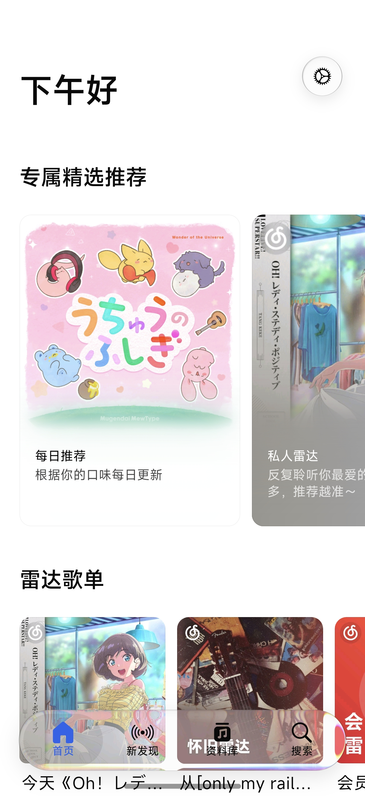
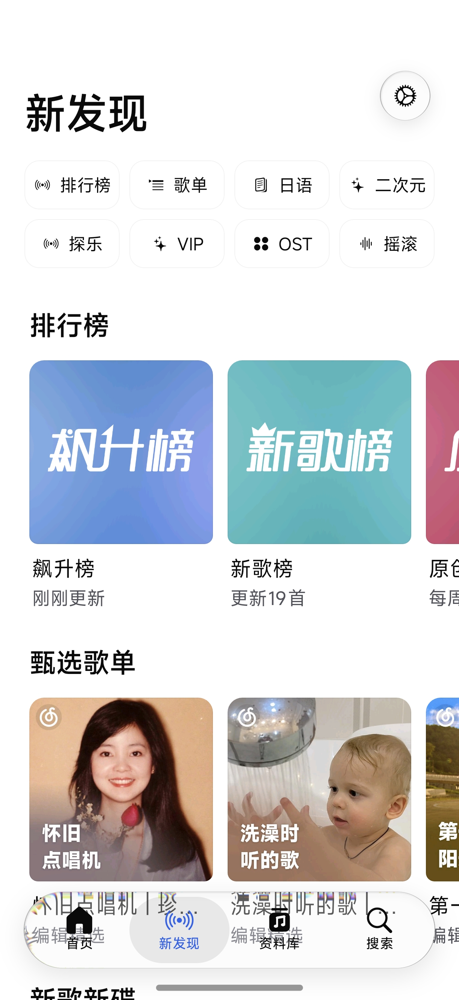
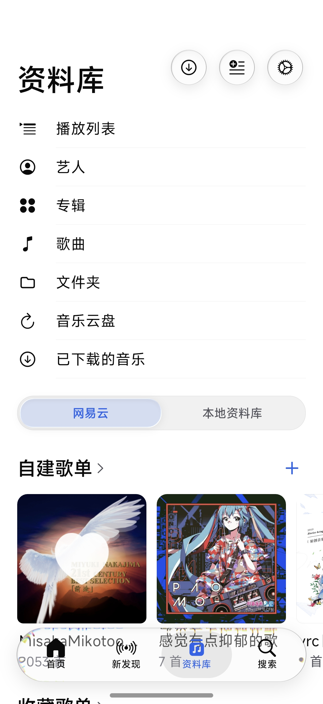
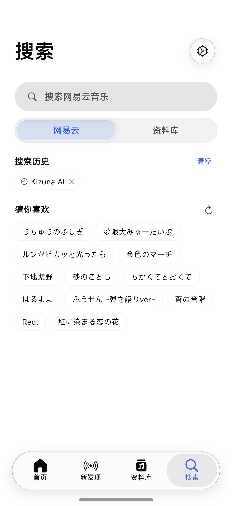
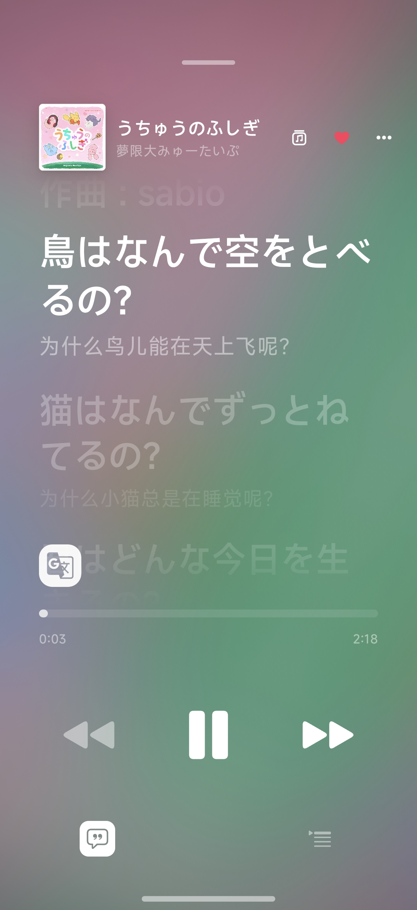
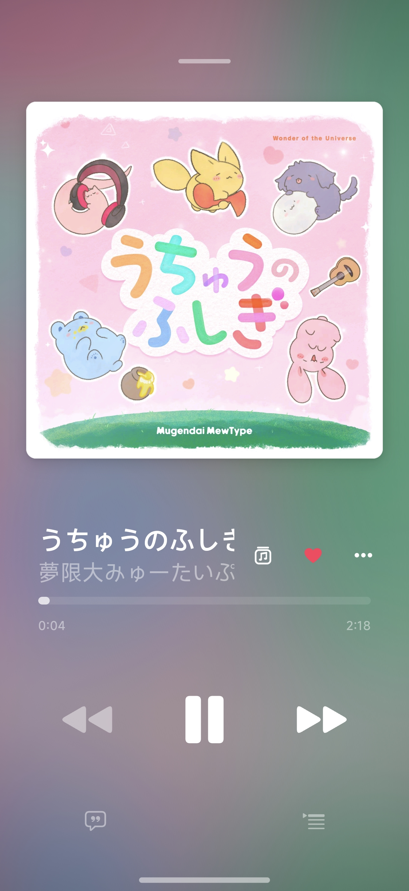

<h1 align="center">Trove</h1>

<p align="center"><b>A third-party NetEase Cloud Music client and local player for Android</b><br />Online streaming, local library, desktop library sync — in one app.</p>

<p align="center">


</p>

<p align="center"><a href="README.md">English</a> · <a href="README.zh-CN.md">简体中文</a></p>

> [!IMPORTANT]
> Trove is an unofficial, independently maintained project. It is not affiliated with,
> endorsed by, or connected to NetEase Cloud Music or Apple. Online features rely on
> third-party endpoints and may break at any time; please support the official services.
> The app has no ads and no analytics: apart from the NetEase endpoints themselves it
> uploads nothing, and your login credentials stay on the device.

## Screenshots

<table align="center">
  <tr>
    <td align="center"><br /><sub><b>Home</b></sub></td>
    <td align="center"><br /><sub><b>Discover</b></sub></td>
    <td align="center"><br /><sub><b>Library</b></sub></td>
  </tr>
  <tr>
    <td align="center"><br /><sub><b>Search</b></sub></td>
    <td align="center"><br /><sub><b>Lyrics</b></sub></td>
    <td align="center"><br /><sub><b>Now Playing</b></sub></td>
  </tr>
</table>

## Features

### NetEase Cloud Music

- **Sign in & protocol**: QR code, phone number + password, SMS code, or web login; requests use the official Android `eapi` fingerprint by default with an optional Web compatibility mode.
- **Home & radio modes**: Daily Recommendations (with manual refresh), Private Radar & multi-radar cards, recommended playlists, dynamic home feed sections, and artist new releases — plus **Private Roam (FM with dislike)**, **Heartbeat mode**, and **Similar Songs** continuous auto-queue.
- **Discover & Square**: Rankings, curated playlists, new songs & new albums, and a full Discover Square (category playlists, high-quality playlists, charts, new albums, and top artists).
- **Search**: Seamless switch between NetEase online search (songs, playlists, albums, artists) and local library search, with hot search tags, "Guess you like", live suggestions, and search history.
- **Playlists, albums & artists**: Import playlists by link, create/edit/delete playlists, add/remove/drag-reorder tracks, toggle playlist privacy, save playlists & albums, follow artists, browse paged artist songs & albums, explore similar songs, and read track comments (hot / newest).
- **Cloud Disk, footprints & Likes**: Browse and manage Cloud Disk tracks, view cloud playback footprints (recent / weekly / all-time rankings), configure playback history reporting, and keep online "Like" separate from local favourites in a dedicated "Liked Songs" playlist.
- **Online streaming & cover art**: In-process `FFmpeg AVIOContext` streaming backed by an adjustable local stream cache; automatically pauses on network loss and resumes cleanly; plays trial clips with clear indicators, classifies resolution failures with bounded in-place retries, and lazy-loads 4000×4000 hi-res covers.
- **Downloads & Wi-Fi auto-cache**: Seven quality tiers (Standard, High, Lossless, Hi-Res, HD Surround, Immersive Surround, Ultra-Clear Master) with automatic tier fallback, app-private or custom SAF folder output, notification progress, one-tap full-playlist downloads, and unmetered Wi-Fi playlist auto-cache management.

### Local library & organization

- **Scan & browse**: Scan device audio with optional single-folder whitelist; browse by playlists, artists, albums, tracks, multi-level folders, genres, composers (genres/composers toggleable), and recently added, with an alphabetical fast-scroll index and pull-down instant text filter.
- **Cleanup & matching**: Duplicate track detection and removal, one-tap hiding of short tracks under 40 seconds, per-track hide/unhide management, direct device file deletion, and matching local tracks to NetEase metadata.
- **Smart playlists**: Dynamic playlists built from multi-condition rules on title, artist, album, duration, format, play count, favourite status, and folder path.
- **Metadata & import/export**: Inspect embedded artwork and technical audio tags (codec, sample rate, bit depth, channels/bitrate), set custom playlist covers and artist pictures, **import/export M3U playlists**, and **decode & import encrypted NCM files** with metadata and artwork intact.
- **Batch actions & navigation layout**: Long-press multi-select action bar (queue, favourite, playlist, remove), optional merging of "Mine" and "Library" into a two-tab root page, customizable bottom-dock tab visibility and order, per-tab sub-page memory, and auto-merging bottom bars while scrolling.

### Playback engine & audio

- **Native FFmpeg + AAudio JNI core**: Hardware-friendly decoding for FLAC, MP3, M4A/AAC, OGG, Opus, WAV, AIFF, APE, WavPack, DSF/DFF, WMA, and more; integrates Media3 session, audio focus handling, unplug pause (`AUDIO_BECOMING_NOISY`), and output-route disconnect recovery.
- **Seamless transitions**: Gapless playback (automatically preferring gapless continuity across sequential album tracks) and crossfade up to 12 seconds with blended artwork transitions.
- **Speed, A-B loop & equalizer**: Pitch-preserving **WSOLA speed control (0.5×–2.0×)**, **A-B loop with millisecond fine-tuning**, **sleep timer** (timed countdown or end of current track), and a **10-band equalizer (±12 dB)** with built-in presets and custom saved profiles.
- **Dynamic loudness normalization**: **BS.1770 LUFS** track/album analysis and gain control with adjustable target loudness and clip protection.
- **Queue & system controls**: Play next, add to queue, queue deduplication, drag reorder, remove, shuffle & repeat, and persistent queue/position restoration across restarts; quality badges (Lossless / Hi-Res / DSD) and audio details dialog, optional volume slider, system output switcher, **3 media notification styles** (Default / Large Artwork / Extended Controls), **home-screen widget**, and **Quick Settings tile**.

### Lyrics & alignment

- **Rich lyric rendering**: Word-level (yrc) karaoke, translations, romanisation, duet lines split by singer, interlude dots, tap-to-seek, manual lyrics search/replace, per-track offset calibration, and **LRC export**.
- **Multi-source & per-song memory**: NetEase → AMLL → LRCLIB → Kugou with custom source ordering, individual toggles, dedicated word-timing fallback source, and per-song source & alignment preferences.
- **On-device ONNX forced alignment**: Generates word-level timings locally via trimmed ONNX Runtime when only line lyrics exist; Chinese, English, and Japanese models (plus OpenJTalk dictionary) download on demand with progress, cancel, and delete controls.
- **Motion & system lyrics**: Configurable lyric spring strength, focus-return delay, and auto-fullscreen lyrics; supports **Lyricon**, **media notification lyrics** (lyric-first / song-first), **standalone lyrics notification**, and **HyperOS Super Island**.

### Interface, insights & extras

- **Themes & Liquid Glass**: System / Light / Dark / **AMOLED** themes, 5 accent colours, 2 icon styles (Material / Apple SF Symbols style), 2 control styles (Frosted / adjustable-blur **Liquid Glass**), reduce transparency, and keep-screen-on option.
- **Five now-playing themes**: Standard, Adaptive colours, **Apple artwork flow** (Kawarp pipeline with 9 tunable sliders), Distorted pixels, and **GL dynamic backdrop** (**Mesh gradient** 8-preset pool + **Titanium flowing sand** with tunable grain, sparkle, sheen, metalness, crest, dithering, and scrim), plus independent adaptive text colour and 3 lyric font sizes.
- **Continuous morphing motion**: Seamless MiniPlayer-to-fullscreen morph aligned to the device's display corner radius with coordinated dock retreat/return, dock glass lens, and sticky drag physics.
- **Local insights & annual report**: Library growth curve, audio quality & genre mix, listening time, completion & skip rates, streak & average session length, daily listening heatmap, listening footprints timeline, and yearly report — all computed locally.
- **12 UI languages**: Chinese, English, Japanese, Korean, German, Spanish, French, Italian, Portuguese, Russian, Thai, and Vietnamese.
- **Novelty toggles & Easter eggs**: Individually toggleable fun audio/visual modes and hidden Easter eggs tucked inside the app for you to discover.

### Desktop sync, backup & storage

- **Desktop music library sync**: Pair over LAN, mesh, or public HTTPS addresses with a 6-digit pairing code and TLS certificate fingerprint pinning; supports multi-address switching, remote streaming, and an adjustable local prefetch cache.
- **Full ZIP backup & restore**: Export and restore preferences, local & smart playlists, favourites, listening stats, lyric offsets, per-song lyric configs, and custom covers (explicitly excluding account cookies, sync tokens, and caches) with Zip-Slip and size safeguards.
- **Storage manager & updates**: Inspect device space, downloads, and four cache buckets (stream, prefetch, image, hi-res cover) with per-bucket size limits and selective or one-tap cleanup; in-app update checks via GitHub Releases.

## Download

Get the APK from [Releases](https://github.com/MisakaMkotoo/Trove/releases). Current version: **1.2.0-beta**.
APKs are split per ABI (`arm64-v8a` preferred, plus `armeabi-v7a` and `x86_64`).

Requires **Android 12 (API 31) or newer** (`targetSdk = 36`). You will need to allow installs from this source once.

## Tech stack

- Kotlin Multiplatform: `androidApp` + `sharedLogic`, Compose Multiplatform 1.11.1 / Material3.
- Native playback core: FFmpeg 8.1.2 + AAudio (JNI), OpenSSL 3.0.x.
- ONNX Runtime 1.32.0 (trimmed operator set) for lyric forced alignment.
- Media3 media session, Haze blur, Vico charts, DataStore.
- Toolchain: Kotlin 2.4.10, AGP 9.3.1, Gradle 9.5.0, JDK 21, NDK 30.0.16248370.

## Building

Requirements:

- JDK 21
- Android SDK 37 (`compileSdk = 37`, `targetSdk = 36`, `minSdk = 31`)
- Android NDK 30.0.16248370
- The Gradle wrapper bundled in this repository

Prebuilt FFmpeg and ONNX Runtime `.so` files are not distributed with the repository (`androidApp/src/main/jniLibs/` is ignored). Generate them first:

```bash
# FFmpeg for all ABIs
bash scripts/build-ffmpeg-android.sh all

# ONNX Runtime with the trimmed operator set (lyric alignment)
bash scripts/build-onnxruntime-android.sh
```

Then:

```bash
# Debug build
./gradlew :androidApp:assembleProdDebug

# Release build (requires signing env vars)
export MOBILE_KEYSTORE_FILE=/path/to/keystore
export MOBILE_KEYSTORE_PASSWORD=...
export MOBILE_KEY_ALIAS=...
export MOBILE_KEY_PASSWORD=...
./gradlew :androidApp:assembleProdRelease
```

Without the signing variables the release build falls back to the debug signature, which is only suitable for local testing.

## Project layout

```text
androidApp/     Android app (Compose UI, playback service, NetEase, sync)
sharedLogic/    Shared playback queue and library models
scripts/        FFmpeg / OpenSSL / ONNX Runtime build and tooling scripts
tools/          Font subsetting and romanization data
licenses/       Full third-party license texts
brand/          App icon sources
fastlane/       Store metadata
```

## Upstream and acknowledgements

Trove started from **Tune** by [exodi_dio](https://github.com/Exodi-dio) (GPL-3.0), a local music player,
and has since been rebuilt into a NetEase Cloud Music third-party client. The player, UI, NetEase integration,
and sync features have been substantially rewritten; it is not an official branch of Tune.

- Interface design language: [Airmedy](https://github.com/misa198/airmedy) by misa198 (GPL-3.0).
- Some artist-page interactions adapted from [BitChord](https://github.com/kushagrasinghx/BitChord) (GPL-3.0).
- Lyric forced-alignment pipeline and ONNX models follow [MeloX-Android](https://github.com/lladlam/MeloX-Android) (GPL-3.0), which also provides the SF Symbols icon mapping.
- NetEase endpoints, lyric source ranking, and request fingerprinting are heavily informed by [MeiloX](https://github.com/MeiloX/MeiloX) (GPL-3.0); no code is reused directly.
- Glass motion adapted from Glasmio (NEORUAA) and AndroidLiquidGlass (Kyant0); the artwork-flow backdrop is based on Kawarp (Better Lyrics); NCM decoding follows ncmdump.
- Full component and provenance list: [NOTICE](NOTICE).

## License

Licensed under the **GNU General Public License v3.0 (GPLv3)** — see [LICENSE](LICENSE).
As a GPLv3 derivative, redistributing modified builds requires keeping the copyright notices and license, and providing the corresponding source.
