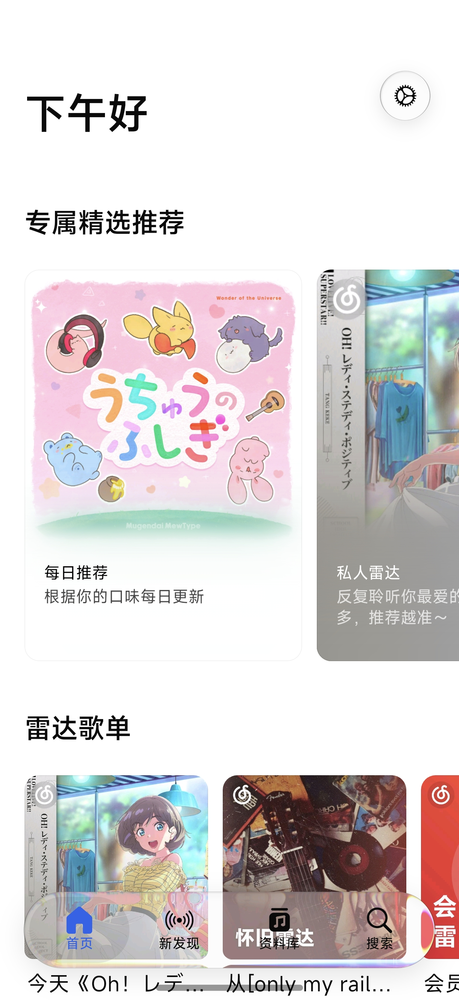
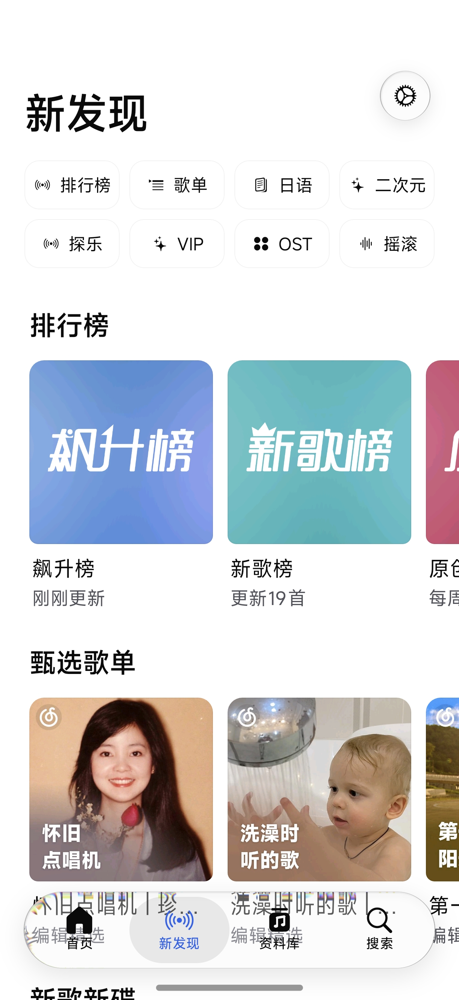
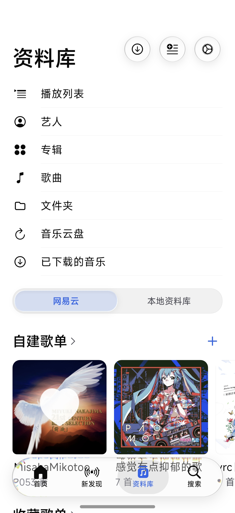
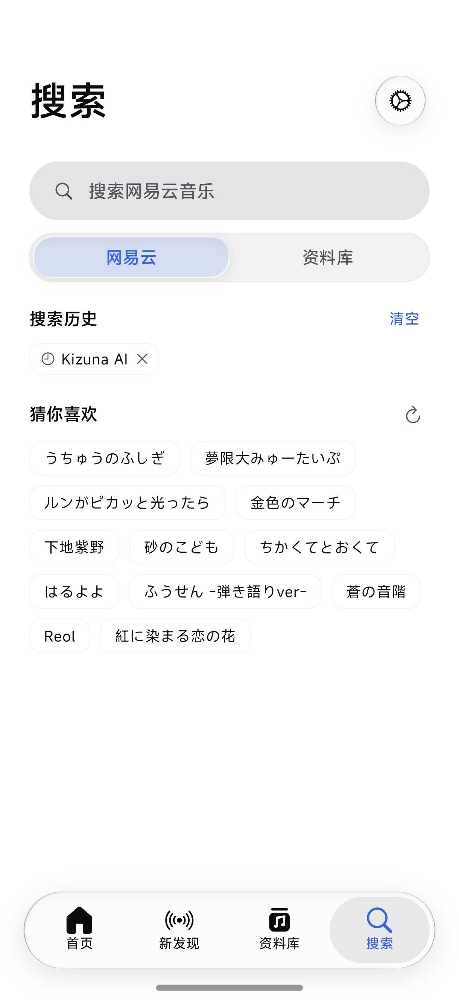
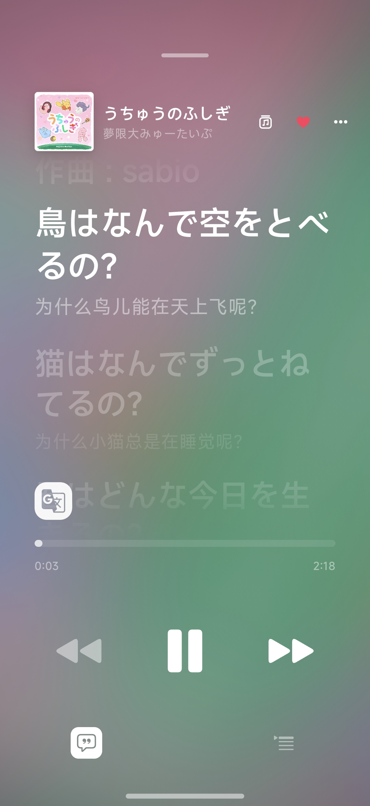
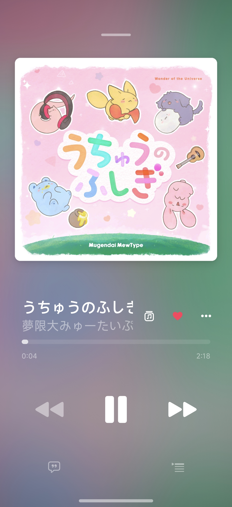

<h1 align="center">Trove</h1>

<p align="center"><b>网易云音乐第三方 Android 客户端 · 本地音乐播放器</b><br />在线流媒体、本地曲库、电脑音乐库同步，一个应用里。</p>

<p align="center">


</p>

<p align="center"><a href="README.md">English</a> · <a href="README.zh-CN.md">简体中文</a></p>

> [!IMPORTANT]
> Trove 是个人维护的非官方项目，与网易云音乐、Apple 均无关联，也未获得其授权或认可。
> 在线功能依赖第三方接口，可能随时失效；请优先使用正版服务。
> 应用无广告、无统计上报；除网易云接口本身外不向任何服务器上传数据，登录凭据只保存在本机。

## 界面预览

<table align="center">
  <tr>
    <td align="center"><br /><sub><b>主页</b></sub></td>
    <td align="center"><br /><sub><b>新发现</b></sub></td>
    <td align="center"><br /><sub><b>资料库</b></sub></td>
  </tr>
  <tr>
    <td align="center"><br /><sub><b>搜索界面</b></sub></td>
    <td align="center"><br /><sub><b>歌词界面</b></sub></td>
    <td align="center"><br /><sub><b>播放界面</b></sub></td>
  </tr>
</table>

## 功能

### 网易云音乐

- 登录：扫码、手机号 + 密码、短信验证码；请求走官方 eapi 指纹，可切换网页兼容模式。
- 首页：每日推荐、私人雷达、心动模式、推荐歌单。
- 发现：歌单广场、新碟上架、歌手榜、推荐歌单。
- 搜索热词与搜索联想。
- 歌单：链接导入、创建与编辑、收藏、排序与隐私设置。
- 云盘、听歌足迹（云端播放记录）。
- 歌手详情（分页歌曲与专辑）、专辑收藏、相似歌曲、歌曲评论（热门 / 最新）。
- 「喜欢」与本地收藏分离，在线收藏独立呈现为「我喜欢的音乐」。
- 在线播放：试听片段照常播放并提示；取流失败自动分类并做有限重试；进程内 FFmpeg 取流 + 本地流缓存，网络中断时暂停等待恢复。
- 下载：多档音质、自定义保存目录、通知栏进度；Wi-Fi 下歌单自动缓存。

### 本地曲库

- 扫描设备音频，按曲目、艺人、专辑、流派、作曲家、文件夹、歌单浏览与搜索。
- 最近添加、重复曲目清理、隐藏 40 秒以下的音频。
- 智能歌单：按标题、艺人、专辑、时长、格式、播放次数、收藏、文件夹等字段组合规则。
- 自定义歌单封面与艺人图片；专辑封面取自内嵌图片。
- M3U 歌单导入与导出、NCM 文件解码导入。
- 批量多选操作；「我的」与「曲库」可合并，底部标签页可显隐与排序。

### 播放引擎

- 自研 FFmpeg + AAudio JNI 内核：FLAC、MP3、M4A/AAC、OGG、Opus、WAV、AIFF、APE、WavPack、DSF/DFF、WMA 等。
- 无缝衔接（gapless）与最长 12 秒交叉渐变，跨曲封面混合过渡。
- WSOLA 变速 0.5×–2.0×（不变调）、A-B 区间复读、睡眠定时（按时长或播完本曲）。
- 10 段均衡器，内置多套预设并支持自定义配置档。
- BS.1770 LUFS 动态音量标准化：单曲 / 专辑模式、可调目标响度、防削波。
- 队列：下一首播放、加入队列、拖动排序、移除；随机与循环。
- 播放控制：通知栏与媒体会话、桌面小组件、快捷设置磁贴、系统输出切换。

### 歌词

- 逐字（yrc）卡拉 OK、翻译、罗马音、对唱按演唱者分边、间奏三点。
- 来源：网易云 → AMLL → LRCLIB → 酷狗，顺序与开关可配，按曲记忆，可手动切换。
- 缺少逐字歌词时，可用 ONNX 模型在本地做强制对齐（中 / 英 / 日），模型与词典按需下载。
- 系统歌词：Lyricon 提供端、媒体通知歌词、独立歌词通知、HyperOS 超级岛。
- LRC 导出、歌词偏移校准。

### 界面与视觉

- Apple Music 风格视觉：玻璃与模糊、Liquid Glass 控件、流沙与网格动态背景（Kawarp 封面管线与苹果式模糊）。
- 五种「正在播放」主题：标准、自适应取色、苹果式封面流动、扭曲像素、GL 动态背景（多套网格预设可调）。
- 可独立开启的「自适应字体颜色」、图标风格、控件风格与强调色。
- 弹性动画体系：形变过渡、歌词 2D 物理、底部玻璃透镜与粘性拖拽。
- 12 种界面语言、深浅色模式、减少透明度选项。
- 数据分析：曲库增长、音质分布、流派分布、播放结果、听歌热力图、足迹时间线与年度报告（全部本地统计）。
- 趣味效果：磁带、电台串音、黑胶磨损、陀螺旋钮、重力歌词，可逐项开关。
- 彩蛋功能：留待自行发现。

### 数据与同步

- 电脑音乐库同步：局域网 / 组网 / 公网地址，配对码 + 证书指纹校验。
- 设置与数据备份导出、恢复。
- 流缓存、封面缓存、资源库缓存的容量管理与清理。
- 应用内检查更新（GitHub Releases）。

## 下载

从 [Releases](https://github.com/MisakaMkotoo/Trove/releases) 下载 APK。当前版本：**1.2.0-beta**，
APK 按 ABI 拆分（`arm64-v8a` 优先，另有 `armeabi-v7a` 与 `x86_64`）。

系统要求：**Android 12（API 31）及以上**（`targetSdk = 36`）。首次安装需要在系统设置里允许来自该来源的安装。

## 技术栈

- Kotlin Multiplatform：`androidApp` + `sharedLogic`，Compose Multiplatform 1.11.1 / Material3。
- 原生播放内核：FFmpeg 8.1.2 + AAudio（JNI），OpenSSL 3.0.x。
- ONNX Runtime 1.32.0（可按需裁剪算子）用于歌词强制对齐。
- Media3 媒体会话、Haze 模糊、Vico 图表、DataStore 持久化。
- 工具链：Kotlin 2.4.10、AGP 9.3.1、Gradle 9.5.0、JDK 21、NDK 30.0.16248370。

## 构建

环境要求：

- JDK 21
- Android SDK 37（`compileSdk = 37`，`targetSdk = 36`，`minSdk = 31`）
- Android NDK 30.0.16248370
- 使用仓库自带的 Gradle wrapper

FFmpeg 与 ONNX Runtime 的预编译 `.so` 不随仓库分发（`androidApp/src/main/jniLibs/` 已在 `.gitignore` 中）。首次构建前先生成：

```bash
# 全部 ABI 的 FFmpeg
bash scripts/build-ffmpeg-android.sh all

# 精简算子集的 ONNX Runtime（歌词对齐用）
bash scripts/build-onnxruntime-android.sh
```

然后：

```bash
# 调试包
./gradlew :androidApp:assembleProdDebug

# 发布包（需要签名环境变量）
export MOBILE_KEYSTORE_FILE=/path/to/keystore
export MOBILE_KEYSTORE_PASSWORD=...
export MOBILE_KEY_ALIAS=...
export MOBILE_KEY_PASSWORD=...
./gradlew :androidApp:assembleProdRelease
```

未配置签名环境变量时，release 包会退回 debug 签名，仅适合本地测试。

## 项目结构

```text
androidApp/     Android 应用（Compose UI、播放服务、网易云、同步）
sharedLogic/    共享的播放队列与曲库模型
scripts/        FFmpeg / OpenSSL / ONNX Runtime 构建脚本与工具脚本
tools/          字体子集、罗马化数据
licenses/       第三方许可证全文
brand/          应用图标源文件
fastlane/       应用商店元数据
```

## 上游与致谢

Trove 最早由 **Tune**（作者 [exodi_dio](https://github.com/Exodi-dio)，GPL-3.0）这个本地播放器起步，
如今已重做为网易云音乐第三方客户端；播放器、界面、网易云集成与同步功能均做了大量重写，并非 Tune 的官方分支。

- 界面设计语言源自 [Airmedy](https://github.com/misa198/airmedy)（GPL-3.0）。
- 部分艺人页交互参考 [BitChord](https://github.com/kushagrasinghx/BitChord)（GPL-3.0）。
- 歌词强制对齐管线与 ONNX 模型来源参考 [MeloX-Android](https://github.com/lladlam/MeloX-Android)（GPL-3.0），SF Symbols 图标映射同样取自该项目。
- 网易云接口、歌词来源择优与请求指纹等实现大量参考 [MeiloX](https://github.com/MeiloX/MeiloX)（GPL-3.0），未直接复用其代码。
- 玻璃动效参考 Glasmio（NEORUAA）与 AndroidLiquidGlass（Kyant0）；封面流动背景基于 Kawarp（Better Lyrics）管线；NCM 解码参考 ncmdump。
- 第三方组件与来源的完整清单见 [NOTICE](NOTICE)。

## 许可证

本项目使用 **GNU General Public License v3.0（GPLv3）**，详见 [LICENSE](LICENSE)。
作为 GPLv3 衍生作品，分发修改版时需保留版权声明与许可证，并提供对应源码。
